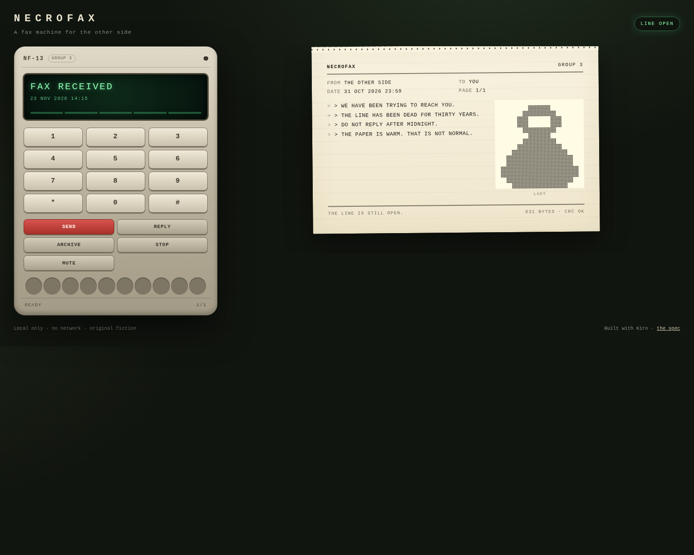

# NecroFax

**A fax machine for the other side: a dead technology revived in the browser, with a real frame codec, a simplified T.30 handshake and a thermal-paper fax that prints from a queue of original ghost stories.**

Built spec-first with **Kiro** for **Kiroween 2026**, in the **Resurrection** category.



## The idea

The fax machine is dead. NecroFax brings it back as a local-first web app:

- **A real frame codec** — magic header, 1-bit bitmap, run-length encoding and a
  CRC32. The paper is encoded, decoded and only then printed.
- **A simplified T.30 handshake** — `IDLE → DIAL → CNG → CED → DIS → DCS →
  TRAIN → MPS → EOP → DCN → DONE`, with tones, timeouts and an error state.
- **A thermal-paper fax** — header, meta, body, ghost bitmap and a footer with
  the frame size and `CRC OK`.
- **A conversation** — reply to the fax, dial a number and send one, or open the
  archive and reprint any fax.
- **Local-first** — `localStorage`, no network, no accounts, no tracking.

## What it does

| Action | What happens |
|---|---|
| **On load** | A fax arrives from the other side, the line handshakes and the paper prints |
| **REPLY** | Opens a dialog, swaps sender and receiver, prints the reply |
| **Keypad + SEND** | Dials `000-0000`, validates the number and prints a sent fax |
| **ARCHIVE** | Lists every fax, searches it and reprints one |
| **STOP** | Stops the handshake and returns the line to `NO LINE` |
| **MUTE** | Toggles the line tones; the first fax is silent |

## Why it is a resurrection

A fax machine is a dead technology: a dedicated line, a handshake, a thermal
printer and a piece of paper. NecroFax keeps the parts that made it a machine —
the frame format, the handshake states and the paper — and removes the parts that
killed it: the phone line, the driver and the server. The result is not a fax-themed
dashboard; it is a fax machine you can use. It is built for students, educators and
retro-computing enthusiasts who want to see how a still-used protocol actually
works — with no setup, no account and no network.

## How it uses Kiro

The `.kiro/` folder is committed at the repository root as the hackathon requires:

- **Spec** — `.kiro/specs/necrofax/requirements.md`, `design.md`, `tasks.md`.
  The requirements define the user stories and the acceptance criteria; the design
  fixes the frame format, the state machine and the UI; the tasks are the plan.
- **Steering** — `.kiro/steering/product.md`, `tech.md`, `structure.md`.
  The agent reads the vision, the stack constraints and the file layout first.
- **Hooks** — `.kiro/hooks/on-save-tests.kiro.hook` runs `npm test`;
  `.kiro/hooks/on-save-syntax.kiro.hook` runs `node --check` on the app files.

The workflow is spec-first: read the spec, keep the steering current, let the hook
run the tests on save. See [`.kiro/README.md`](.kiro/README.md).

## The frame

```
magic "NECROFAX" (8) | version (1) | width (2) | height (2)
from (2 + n) | to (2 + n) | date (2 + n) | page (2) | pages (2)
line count (2) | line (2 + n) each
run count (2) | run (2 + 1) each
crc32 (4) over every previous byte
```

The bitmap is 1-bit and run-length encoded. `decodeFax` rejects a bad magic, a
bad CRC, trailing bytes and bad runs. The full reference is in
[`docs/PROTOCOL.md`](docs/PROTOCOL.md).

## The handshake

```
IDLE → DIAL → CNG → CED → DIS → DCS → TRAIN → MPS → EOP → DCN → DONE
```

`timeout` goes to `ERROR`; `stop` returns to `IDLE`; an invalid event goes to
`ERROR`. Each state has an LCD description and a tone; the UI plays it through Web
Audio when the line is not muted. This is a simplified T.30, not a real modem.

## Run

Requires a browser and, for the tests, Node 20+.

```bash
npm test          # 34 tests
npm run serve     # http://127.0.0.1:8000/
```

Or without Node:

```bash
python3 -m http.server 8000 --directory app
# open http://127.0.0.1:8000/
```

There is no build step and no dependency to install.

## Try these

- Wait for the first fax; read the paper and the ghost.
- Press **MUTE** to hear the line, then **REPLY** and send a reply.
- Dial `013-1313` on the keypad and press **SEND**.
- Press **ARCHIVE**, search `well`, and reprint the fax.
- Open `?demo=archive`, `?demo=reply` or `?demo=sent` to jump to a state.

## Tests

```bash
npm test
```

34 tests cover:

- sample faxes, ids, ghosts and 16×16 patterns;
- bitmap scaling, fax lines, document model, reply/sent and search;
- CRC32, run-length encode/decode and the full frame round-trip;
- bad magic, corrupt CRC, trailing bytes and bad runs;
- the full handshake, invalid events, timeout, stop, tones and descriptions;
- archive add/get/list/search/clear/seed and a storage round-trip.

## Data and provenance

`app/data.js` contains five original faxes and five original 16×16 ghost
patterns. Any resemblance to real people, places or phone numbers is coincidental.
There are no third-party assets, fonts, images, sounds or trademarks. The code is
MIT (`LICENSE`).

## Accessibility

Every control is a native button or input. The line status is
`aria-live="polite"`. The reply dialog uses `<dialog>` and focuses the textarea.
The paper, LCD and status are `aria-live`; the paper canvas has an accessible
label; `prefers-reduced-motion` stops the paper, LED and wave animations; focus
is always visible; the app works without a mouse.

## Demo

- **App:** <https://agarnung.github.io/necrofax/>
- **Video:** <https://youtu.be/UFInbA85Xxo> (2:01.5, public)
- **Kiro write-up:** [`KIRO.md`](KIRO.md)

## License

MIT. See [`LICENSE`](LICENSE).
